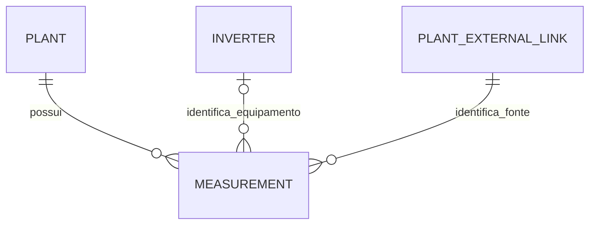

# Histórico de medições — Tarefa 10

## Diagnóstico e decisão

Branch inspecionada: `main`, sem alterações locais no início. O `ProviderAdapter.listarUsinas` retorna `UsinaLida`: potência instantânea (`currentPowerKw`), acumulador diário (`todayEnergyKwh`), acumulador total (`totalEnergyKwh`), status e `lastDataAt`. Não retorna leituras individuais de inversores, início/fim de intervalos de produção nem garantia de completude. O provedor disponível continua sendo DEMO.

Foi criada uma tabela histórica independente, sem backfill a partir de Plant. Os valores atuais de Plant continuam sendo a projeção operacional existente. Nenhuma medição é fabricada para preencher lacunas, nenhuma leitura antiga é atribuída ao horário da coleta e nenhuma energia diária é reinterpretada como energia de um intervalo fechado. DemoAdapter e ProviderAdapter não foram alterados.

## Modelo

`Measurement` contém:

| Campo                              | Significado                                                                               |
| ---------------------------------- | ----------------------------------------------------------------------------------------- |
| `id`                               | UUID interno gerado pelo Prisma                                                           |
| `plantId`                          | Usina obrigatória                                                                         |
| `inverterId`                       | Opcional; null significa leitura agregada da usina                                        |
| `sourceLinkId`                     | Vínculo externo que identifica a origem, preservado após desvinculação                    |
| `sourceProvider`, `isSimulated`    | Provedor no momento da ingestão e identificação explícita de DEMO                         |
| `measuredAt`                       | Instante da leitura em TIMESTAMPTZ(3), normalizado em UTC na aplicação                    |
| `powerKw`                          | Potência instantânea em kW, opcional                                                      |
| `totalEnergyKwh`                   | Acumulador total em kWh, opcional                                                         |
| `periodEnergyKwh`, `periodStartAt` | Energia de intervalo declarado `[periodStartAt, measuredAt)`, ambos opcionais em conjunto |
| `operationalStatus`                | Estado reportado na leitura, opcional                                                     |
| `quality`, `qualityReason`         | VALID, PARTIAL ou INVALID e motivo quando necessário                                      |
| `recordedAt`                       | Instante de registro no SolarSystem, independente da data de medição                      |



FKs compostas asseguram que inversor e fonte pertençam à mesma usina da medição. Foram acrescentadas chaves únicas `(id, plantId)` nas tabelas de inversores e vínculos para suportá-las. Exclusões dos pais usam RESTRICT; equipamentos arquivados e fontes desvinculadas continuam consultáveis no histórico. Não há cascata de limpeza de medições.

Valores usam DOUBLE PRECISION, como as potências/métricas atuais. São dados de monitoramento aproximados, não contabilidade/faturamento. Precisão decimal e política de arredondamento para faturamento exigem modelagem própria.

## Integridade e deduplicação

- Chave única por `(sourceLinkId, inverterId, measuredAt)` para inversores.
- Índice único parcial `(sourceLinkId, measuredAt) WHERE inverterId IS NULL` para leituras agregadas; trata explicitamente a semântica de NULL do PostgreSQL.
- O writer utiliza INSERT com prevenção de duplicidade e compara o payload persistido. Repetição idêntica é idempotente; divergência gera 409, sem sobrescrever a amostra. `recordedAt` permanece o primeiro registro.
- Instantes equivalentes em diferentes offsets representam a mesma chave. Não arredondar timestamps para o intervalo de coleta, nem deduplicar por horário de registro.
- Trigger SQL impede UPDATE de medições aceitas. Correções exigem desenho explícito de conciliação/versionamento, fora do endpoint atual. Não há endpoint de edição/exclusão nem rotina automática de retenção.
- CHECKs recusam números negativos, NaN/infinito, intervalo sem energia/início correspondente ou com duração não positiva e classificação DEMO sem `isSimulated=true`.
- VALID exige ao menos uma grandeza disponível. PARTIAL/INVALID exigem motivo. Valores numéricos inválidos não são armazenados como se fossem válidos; uma futura quarentena deve preservar payload bruto separadamente, com sanitização/controle de acesso, não transformar valor inválido em zero.

Dados DEMO são armazenados como simulação, mesmo quando o snapshot é estruturalmente VALID. Qualidade descreve validade estrutural, não certificação/calibração do medidor. Um acumulador menor que o anterior pode significar reset/troca de equipamento; não é convertido automaticamente em energia negativa, zero ou produção estimada.

## Fluxo de armazenamento

`recordSnapshot` é chamado pelo `PlantCatalogService` na importação confirmada e na sincronização de vínculo existente, dentro da mesma transação do catálogo. Falha de histórico reverte o conjunto; não deixa histórico aceito sem sua atualização operacional ou vice-versa.

Sem `lastDataAt`, nenhuma medição é criada. Com timestamp e potência/acumulador ausentes, grava null e PARTIAL com motivo. Com ambos disponíveis, grava VALID. `todayEnergyKwh` continua na projeção existente de Plant, mas não é somado nem copiado como energia de período. Descobertas pendentes e identidades DETACHED não geram medições. O writer não altera diretamente Plant.

O fluxo atual mantém a política existente de rejeitar snapshots anteriores à última amostra aceita. Não foi introduzido importador de leituras históricas fora de ordem. Tampouco foi criado ingest individual de inversores ou de energia de período, pois o contrato atual não fornece esses dados. A tabela/consulta/agregação estão preparadas para essas modalidades, aguardando adaptador e política autorizados. Não há entrada manual de medições pela API.

## Consultas e acesso

Todos os endpoints exigem os guards atuais. ADMIN/OPERATOR podem consultar as usinas; CLIENT somente as do seu `clientId`. Cliente sem vínculo e usina alheia recebem 404. O filtro de propriedade é reaplicado na consulta das medições. Fonte/inversor informado deve pertencer à usina; não é necessário estar ativo hoje para consultar passado.

Histórico:

```text
GET /api/plants/:plantId/measurements
  ?from=2026-01-01T00:00:00Z
  &to=2026-02-01T00:00:00Z
  &pagina=1&porPagina=100
```

O intervalo dos pontos é `[from, to)`, máximo 366 dias. Datas devem incluir Z ou offset. Paginação padrão 100, máximo 1000 por página, ordem estável por `(measuredAt, id)`. `sourceLinkId` pode filtrar uma fonte; `inverterId` seleciona um equipamento, e sua ausência seleciona **somente agregado da usina**, sem misturar/somar inversores. `includeSimulated=true` inclui DEMO; o padrão exclui simulações. O retorno traz `itens`, `total`, `pagina` e `porPagina`, com datas serializadas em UTC.

Agregação:

```text
GET /api/plants/:plantId/measurements/aggregations
  ?from=2026-01-01T00:00:00Z
  &to=2027-01-01T00:00:00Z
  &sourceLinkId=11111111-1111-4111-8111-111111111111
  &period=month&timeZone=America/Sao_Paulo
```

`sourceLinkId` é obrigatório para não somar fontes concorrentes/substituídas. `period` aceita day/month/year; `timeZone` aceita fusos reconhecidos pelo Intl do runtime e assume UTC quando omitido. O intervalo máximo é 3660 dias e há limite de 50.000 medições candidatas por chamada; exceder retorna 422, sem truncamento silencioso. O UUID acima é apenas exemplo.

Consulta SQL conceitual dos pontos (a implementação usa Prisma parametrizado e filtro adicional de cliente):

```sql
SELECT * FROM measurements
WHERE plant_id = $1 AND inverter_id IS NULL
  AND measured_at >= $2::timestamptz AND measured_at < $3::timestamptz
  AND is_simulated = false
ORDER BY measured_at, id
LIMIT $4 OFFSET $5;
```

Índices: `(plantId, measuredAt, id)` para histórico por usina/período e `(inverterId, measuredAt)` para equipamentos; as chaves de deduplicação também atendem consultas por fonte/equipamento/instante.

## Agregações corretas

Não se usa SUM de `powerKw`, SUM de `totalEnergyKwh` nem SUM de acumuladores diários. Não se calcula energia por diferença de acumuladores, integração de potência, interpolação ou duração supostamente fixa entre coletas.

Cada bucket retorna contagem de amostras, amostras utilizáveis, pico **observado** de potência e `observedPeriodEnergyKwh`: soma somente de períodos explícitos VALID, não sobrepostos, integralmente contidos no recorte e no mesmo bucket civil. Sem períodos aceitos, o resultado de energia é null, não zero. Sobreposições excluem os períodos envolvidos; intervalos que cruzam fronteiras não são rateados. Há contadores `acceptedPeriods`/`excludedPeriods` e identificação de simulação.

O retorno usa `coverage=NOT_ESTABLISHED`: mesmo somas válidas de períodos observados não demonstram cobertura completa de um dia/mês/ano. Lacunas permanecem desconhecidas. Não há geração de buckets vazios preenchidos com zero. Um período excluído é contabilizado no bucket do início recortado, sem afirmar energia para os demais buckets atravessados.

As chaves civis são calculadas no fuso solicitado usando Intl/IANA, respeitando mudanças de data/horário de verão. O armazenamento permanece em instantes UTC. O fim de um intervalo energético é exclusivo: intervalo encerrado exatamente à meia-noite pertence ao dia anterior quando integralmente contido nele. Dias não são supostos como sempre tendo 24 horas. Agregação mensal/anual é calculada diretamente dos períodos originais, sem somar resultados diários incompletos.

Com o ProviderAdapter atual, `observedPeriodEnergyKwh` permanecerá null: isso é uma limitação explícita dos dados disponíveis, não falha a preencher com valores sintéticos.

## Migration, crescimento e retenção

Migration preparada: `apps/api/prisma/migrations/20261124050000_measurements/migration.sql`. Cria enum, tabela, índices, FKs, CHECKs e trigger, sem modificar valores de registros existentes. Adiciona somente os índices compostos necessários nas tabelas de pais. Não faz backfill a partir de Plant, nem presume que uma projeção atual represente um histórico completo.

O schema Prisma não representa integralmente os CHECKs, índice único parcial e trigger: preservá-los em migrations futuras. Índices novos em tabelas existentes podem adquirir locks; ensaiar a implantação conforme o volume real. Nenhuma migration foi aplicada a servidor local/real/produção; não foram usados `db push`, reset ou seeds.

Com coleta a cada cinco minutos, um alvo pode produzir aproximadamente 105.120 amostras por ano; inversores multiplicam esse volume. Antes de ampliar a escala:

1. Medir quantidade/dia, tamanho de linha/índices, latência e custo das consultas; usar EXPLAIN em cópia segura.
2. Evoluir paginação para cursor, avaliar BRIN temporal e agregações materializadas com invalidação/correção explícita.
3. Avaliar partições mensais por measuredAt. O desenho de índices únicos/FKs deve ser refeito com cuidado: constraints únicas globais não são automaticamente preservadas só por particionar.
4. Definir retenção aprovada por negócio, exportação/restauração e preservação de dados necessários para auditoria/cálculos. Não há prazo arbitrário nem job que apague registros nesta tarefa.
5. Migrar agregações de grande volume para SQL/preagregados que preservem as mesmas regras; o limite atual evita processamento sem teto na aplicação.

## Arquivos e validação

Alterados: `apps/api/prisma/schema.prisma`, `src/app.module.ts`, `src/plants/plant-catalog.service.ts`, seu teste e `test/app.e2e-spec.ts`. Criados: `src/measurements/*` (writer, schemas, agregação, serviço, controller, módulo e unitários), migration, `test/measurement-migration.test.cjs` e este documento. Caminhos `src`/`test` relativos à API. Não houve alteração visual.

Windows/PowerShell, Node 24.22.3, Prisma 6.19.3. Os comandos foram chamados pelos executáveis locais/runtime, equivalentes aos scripts do workspace:

| Verificação                                                                 | Resultado                                |
| --------------------------------------------------------------------------- | ---------------------------------------- |
| Jest API `--runInBand --no-cache`                                           | PASSOU: 124 unitários, 17 novos          |
| E2E API com VM Modules                                                      | PASSOU: 45 HTTP, 4 novos, Prisma isolado |
| TypeScript API sem emissão                                                  | PASSOU                                   |
| ESLint API `--no-fix`                                                       | PASSOU                                   |
| Build API                                                                   | PASSOU                                   |
| Prisma validate/generate                                                    | PASSOU, sem banco                        |
| Prettier dos arquivos alterados e git diff --check                          | PASSOU                                   |
| Integração SQL em PGlite                                                    | PASSOU: 5 cenários no histórico completo |
| Prisma conectado a PostgreSQL servidor, carga e concorrência multiprocessos | NÃO EXECUTADO                            |

Os unitários cobrem dados ausentes, DEMO, idempotência/conflito, intervalos, sobreposição, exclusão de inválidos, fronteiras civis, dia de 23 horas, agregação diária/mensal/anual, escopo e limites. Os E2E exercitam os novos endpoints com controllers/serviços/guards/JWT reais e Prisma controlado, sem .env/scheduler. O SQL testa migration aditiva, UTC, deduplicação com null/offsets, FKs compostas, qualidade, imutabilidade, consultas e rollback preservando Plant.

O teste SQL usa a ferramenta PGlite opcional externa ao monorepo, conforme [IMPLEMENTACAO_USINAS.md](IMPLEMENTACAO_USINAS.md). Com `PGLITE_MODULE_PATH` configurado, executar `node --test apps/api/test/measurement-migration.test.cjs`; não conecta ao banco do usuário. Esses testes não comprovam comportamento de todos os drivers/erros Prisma em servidor nem desempenho de produção.

Avisos existentes: VM Modules experimental e `package.json#prisma` descontinuado para Prisma 7. A versão Node 26 indicada em `.nvmrc` não foi exercitada. Nenhum commit ou push executado; Tarefa 11 aguarda autorização.
