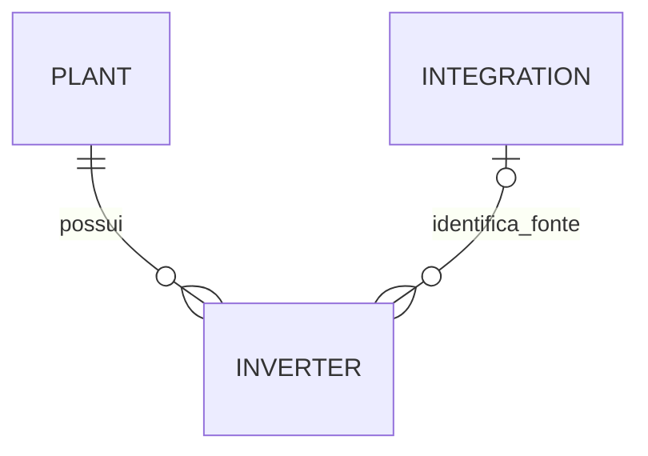

# Entidade de inversores — Tarefa 08

Implementação incremental sobre o modelo unificado de usinas. Branch inspecionada: `main`, sem alterações locais no início. Nenhum banco real foi acessado e nenhuma migration foi aplicada a um servidor.

## Modelo e identidade

`Inverter` possui UUID gerado pelo Prisma, `plantId` obrigatório, `manufacturer`, `model`, `serialNumber`, estado operacional, origem MANUAL/IMPORTED, `createdAt`, `updatedAt`, `lastCommunicationAt` opcional e `revision` para concorrência otimista. As datas de criação/atualização seguem as convenções atuais do Prisma. Uma usina possui vários inversores; não há transferência de usina pelo PATCH.



Fabricante e série são obrigatórios e conservam sua representação de exibição após trim. As chaves internas `manufacturerKey` e `serialKey` são normalizadas para maiúsculas, com unicidade conjunta global, inclusive entre usinas, integrações e equipamentos arquivados. Zeros à esquerda, pontuação e espaços internos são significativos. Fabricantes diferentes podem usar a mesma série; nomes comerciais diferentes do mesmo fabricante exigem padronização operacional, pois não há catálogo de aliases nem correspondência aproximada.

Nesta etapa, fabricante e série aceitam caracteres ASCII imprimíveis, de 1 a 160 caracteres; o modelo aceita texto Unicode de 1 a 160 caracteres. Essa restrição das identidades garante equivalência exata entre a normalização JavaScript e a SQL, sem depender da collation do PostgreSQL. Uma futura ampliação para identificadores Unicode exige política comum de normalização e avaliação de colisões. Não converter séries para número nem remover pontuação.

`integrationId` e `externalId` são ambos nulos para manuais e ambos obrigatórios para importados. `(integrationId, externalId)` é uma segunda chave única: o ID remoto é opaco e local à conta externa, enquanto fabricante/série identificam o equipamento entre contas. A FK de Integration não autoriza nem implementa sincronização. Uma importação futura deve conferir o vínculo ativo da usina, resolver o equipamento existente pela identidade física e conciliar o vínculo explicitamente, nunca duplicar ou transferir silenciosamente.

O endpoint de cadastro cria somente MANUAL. Nenhum campo de origem, integração, ID externo ou comunicação pode ser injetado pelo cliente. A última comunicação permanece nula até existir uma fonte confiável; os estados ONLINE/OFFLINE/FAULT/UNKNOWN de um manual são declarações cadastrais, sem gerar telemetria ou alertas. Não foi inventado adaptador ou fluxo de importação. Equipamentos IMPORTED eventualmente presentes podem ser consultados e arquivados, mas sua edição é bloqueada com 409 até haver política de conciliação. A origem da usina não determina a origem do inversor.

## Endpoints e permissões

Todos exigem a autenticação já existente e usam o prefixo `/api`. UUIDs são validados por `ParseUUIDPipe`. Respostas não expõem chaves normalizadas, motivo/ator do arquivamento ou credenciais da integração.

| Método e caminho                            | Permissão                                | Comportamento                                                                                      |
| ------------------------------------------- | ---------------------------------------- | -------------------------------------------------------------------------------------------------- |
| GET `/api/plants/:plantId/inverters`        | ADMIN, OPERATOR; CLIENT da própria usina | Lista ativos, `pagina` (1+) e `porPagina` (1–100), padrão 20; retorna `itens`, `total` e paginação |
| GET `/api/plants/:plantId/inverters/:id`    | Mesmo escopo                             | Consulta ativo, conferindo equipamento e usina juntos                                              |
| POST `/api/plants/:plantId/inverters`       | ADMIN, OPERATOR                          | Cadastra manual; HTTP 201                                                                          |
| PATCH `/api/plants/:plantId/inverters/:id`  | ADMIN, OPERATOR                          | Edita manual com revisão; HTTP 200                                                                 |
| DELETE `/api/plants/:plantId/inverters/:id` | ADMIN                                    | Arquiva com confirmação; HTTP 200 `{ id, archived: true }`                                         |

CLIENT sem cliente vinculado ou tentando acessar outra usina recebe 404. O filtro do cliente é reaplicado na consulta dos equipamentos. Além dos decorators de perfil, os métodos de escrita do serviço recusam papéis indevidos. Os guards globais de autenticação e autorização não foram alterados.

Exemplo de criação:

```json
{ "manufacturer": "Fabricante Exemplo", "model": "INV-10", "serialNumber": "000123", "status": "UNKNOWN" }
```

O estado é opcional na criação, com padrão UNKNOWN. Omitir estado no PATCH conserva o valor atual; não há aplicação de default durante edição. Exemplo de edição:

```json
{ "revision": 0, "model": "INV-10 revisado" }
```

DELETE requer body JSON, não basta chamar a URL:

```json
{ "revision": 1, "confirmSerialNumber": "000123", "reason": "Equipamento substituído" }
```

Campos desconhecidos são rejeitados por Zod, edição vazia é inválida, revisão é inteiro não negativo e motivo possui 3–500 caracteres. Série de confirmação deve corresponder à chave do registro. Revisão obsoleta/duplicidade gera 409; entrada inválida gera 400; perfil indevido gera 403; registro ausente/arquivado gera 404.

## Segurança de remoção e concorrência

Remover significa preencher `archivedAt`, `archiveReason`, `archivedById` e incrementar revisão. Não há `delete` físico no serviço. A identidade continua reservada e o registro deixa de aparecer nas consultas comuns; não há endpoint público para restaurar ou reutilizar sua série nesta etapa. Se necessário, a restauração deve ser uma operação administrativa futura, preservando o UUID.

As escritas usam a transação de catálogo existente e seu advisory lock. A atualização também compara ID/revisão atomicamente. A constraint única decide duplicidade, inclusive em corridas, sem depender de uma consulta prévia. As FKs de usina e integração usam RESTRICT para impedir exclusão em cascata. A aplicação protege contra remoção acidental; SQL administrativo direto permanece sob responsabilidade do operador do banco.

## Migration e arquivos

`apps/api/prisma/migrations/20261124030000_inverters/migration.sql` cria somente enums, tabela, FKs, índices únicos e CHECKs de origem/identidade, chaves normalizadas, revisão e arquivamento. Não altera registros de usinas nem reescreve migrations anteriores. CHECKs customizados devem ser preservados em migrations futuras, pois não são representados integralmente pelo schema Prisma.

Arquivos modificados:

- `apps/api/prisma/schema.prisma`: modelo, enums e relações inversas de Plant/Integration.
- `apps/api/src/app.module.ts`: registro do módulo.

Arquivos criados:

- Migration `20261124030000_inverters/migration.sql`.
- `apps/api/src/inverters/inverters.module.ts`, `inverters.controller.ts`, `inverters.service.ts`, `inverters.schemas.ts`, `inverters.spec.ts`.
- `apps/api/test/inverter-migration.test.cjs`.
- Este documento.

O Prisma Client foi regenerado localmente. Isso não aplica migrations. Nenhuma dependência ou arquivo visual do painel foi alterado.

## Validação

Windows/PowerShell com Node 24.22.3 e Prisma 6.19.3. Node foi chamado pelo caminho do runtime disponível, pois não estava no PATH da sessão. Com ambiente habitual preparado, os comandos equivalentes abaixo partem da raiz, salvo indicação:

| Verificação/comando                                                                            | Resultado                                                             |
| ---------------------------------------------------------------------------------------------- | --------------------------------------------------------------------- |
| `npm run test:api -- --runInBand --no-cache`                                                   | PASSOU: 84 unitários, sendo 24 novos                                  |
| `npm run test:e2e -- --runInBand --no-cache`                                                   | PASSOU: 41 E2E existentes com mocks; não exercitam os novos endpoints |
| `npm run typecheck --workspace @solarsystem/api`                                               | PASSOU                                                                |
| `npm run lint:check --workspace @solarsystem/api`                                              | PASSOU, sem `--fix`                                                   |
| `npm run build --workspace @solarsystem/api`                                                   | PASSOU                                                                |
| `prisma validate` e `prisma generate` no workspace da API                                      | PASSOU, sem acesso a banco                                            |
| Prettier dos arquivos criados/alterados e `git diff --check`                                   | PASSOU                                                                |
| `node --test apps/api/test/inverter-migration.test.cjs apps/api/test/plant-migration.test.cjs` | PASSOU: 3 cenários SQL em memória                                     |
| Banco real, carga, concorrência entre processos e E2E HTTP dos novos endpoints                 | NÃO EXECUTADO                                                         |

O SQL foi exercitado com PGlite instalado fora do repositório, pelo `PGLITE_MODULE_PATH`, conforme o procedimento em [IMPLEMENTACAO_USINAS.md](IMPLEMENTACAO_USINAS.md). Os testes percorrem as migrations e comprovam preservação das usinas, unicidade física/externa, reserva após arquivamento, origem consistente e FKs restritivas. Os unitários cobrem cadastro, duplicidade, edição, revisão obsoleta, consulta por cliente, arquivamento/confirmacão e o RolesGuard real aplicado aos decorators dos novos endpoints.

Durante a execução, um teste detectou que o default UNKNOWN da criação era herdado pela edição parcial; a validação foi separada para impedir alteração involuntária do estado e aceitar somente PATCH com mudanças explícitas. A suíte final passou. Avisos existentes: VM Modules experimental no Node/Jest e configuração `package.json#prisma` descontinuada para Prisma 7. Node 26 indicado em `.nvmrc` não foi validado nesta sessão.

Antes de qualquer implantação, autorizar o banco de destino, conferir backup e ensaiar o histórico completo em ambiente isolado. Não foram executados migrations em banco real, `db push`, reset, commit ou push. A próxima tarefa aguarda autorização.
