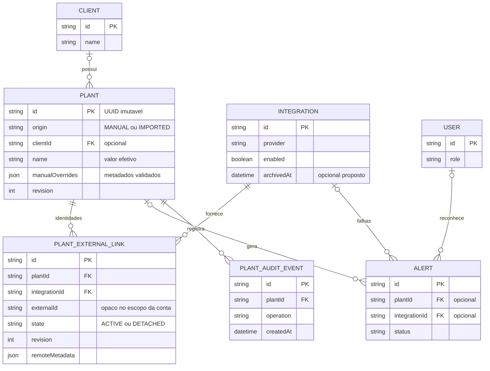

# Modelagem de usinas manuais e integradas

## 1. Escopo e referência

**Proposta para aprovação — Tarefa 06, 23/11/2026.** Não representa funcionalidade implementada nem autoriza migração.

Checkout inspecionado: branch `main`, HEAD `1c3739f`, árvore de trabalho inicialmente limpa. Análise baseada em código, sem conectar ao banco ou inspecionar dados pessoais. Quantidade e qualidade dos registros reais permanecem desconhecidas.

Fontes principais: `apps/api/prisma/schema.prisma`; `src/plants/plants.service.ts`, `plants.controller.ts`, `plants.schemas.ts`; `src/integrations/integrations.service.ts`, `integrations.controller.ts`, `sync.scheduler.ts`; `src/providers/provider.types.ts`; `src/alerts/alerts.service.ts`, `alert-rules.ts` (caminhos `src` relativos a `apps/api`); `apps/painel/src/tipos.ts`, `paginas/Inicio.tsx`; `apps/web/scripts/plant-store.js` e [estratégia frontend](ESTRATEGIA_FRONTEND.md).

## 2. Diagnóstico atual

| Elemento                       | Implementação                                                        | Limitação/risco                                                                                        |
| ------------------------------ | -------------------------------------------------------------------- | ------------------------------------------------------------------------------------------------------ |
| `Plant.id`                     | String gerada por `uuid()`; rotas validam UUID                       | Identidade interna já existe; não trocar na vinculação                                                 |
| `integrationId` / `externalId` | Obrigatórios em Plant                                                | Impedem usina manual sem integração fictícia                                                           |
| Chave composta                 | `@@unique([integrationId, externalId])`, usada no upsert             | Deduplica identidade exata dentro da integração, não cadastros físicos entre contas/manuais            |
| `clientId`                     | FK opcional para Client, `onDelete: SetNull`                         | Define visibilidade do cliente; não identifica conta externa nem autor do cadastro                     |
| Exclusões                      | Integration → Plant e Plant/Integration → Alert usam Cascade         | Exclusão de integração pode apagar usinas e histórico; não há endpoint atual de exclusão/desvinculação |
| PlantsService/Controller       | Listar, consultar e vincular cliente                                 | Sem criação/edição manual geral                                                                        |
| IntegrationsService            | `upsert` com `create: { ...usina, integrationId }` e `update: usina` | Mantém UUID e clientId, mas sobrescreve metadados e telemetria recebidos                               |
| ProviderAdapter                | `testarConexao`, `listarUsinas`, retorno `UsinaLida`                 | Mistura metadados e amostra; não informa completude de lote nem identidade física universal            |
| React `Usina`                  | UUID, nome/localização/capacidade/status/métricas/data/cliente       | Não declara origem/vínculo, embora a API já inclua integração                                          |

CLIENT só enxerga usinas com seu `clientId`; cliente sem vínculo recebe lista vazia. ADMIN/OPERATOR podem vincular cliente. Credenciais pertencem à Integration e não devem ser copiadas para Plant ou DTO público.

O scheduler evita sobreposição apenas no processo. Sync manual e múltiplos processos ainda podem concorrer. `sincronizar()` não verifica explicitamente `enabled`: o filtro aplicado pelo scheduler não garante pausa em todas as entradas.

As regras atuais interpretam `lastDataAt=null` como ausência de comunicação. Aplicá-las a uma manual sem monitoramento geraria falso alerta. O provedor atual é somente DEMO; não há evidência de dados de fabricantes reais.

## 3. Modelo recomendado

### Uma entidade de usina e uma identidade externa subordinada

Manter **Plant como única entidade de negócio**, com UUID imutável, cliente, cadastro e alertas comuns às duas origens. Não criar `ManualPlant` e `ImportedPlant`, nem integração artificial “MANUAL”.

Extrair a identidade externa para **PlantExternalLink**, relação subordinada que armazena origem remota, snapshots e estado da associação. Plant pode existir sem vínculo. Recomenda-se **no máximo um vínculo ativo por usina** nesta etapa, com vários históricos desvinculados. Múltiplas fontes simultâneas exigiriam política de agregação própria, fora do escopo.

Somente tornar os dois IDs opcionais em Plant seria mais simples, mas perderia a reserva da identidade ao desvincular: o próximo upsert poderia criar outra usina. A relação separada resolve esse problema sem criar um segundo modelo de usina.

| Entidade/campos conceituais                                                                                                                                 | Responsabilidade                                                                    |
| ----------------------------------------------------------------------------------------------------------------------------------------------------------- | ----------------------------------------------------------------------------------- |
| Plant: `id`, `origin`, `clientId?`, campos efetivos atuais, `manualOverrides`, `revision`, datas                                                            | Cadastro canônico; `origin` imutável registra criação MANUAL ou IMPORTED            |
| PlantExternalLink: UUID, `plantId`, `integrationId`, `externalId`, `state`, `revision`, `linkedAt`, `detachedAt?`, `remoteMetadata`, última amostra e datas | Identidade e snapshot remotos, reserva contra reimportação; estados ACTIVE/DETACHED |
| Integration: campos atuais e `archivedAt?` proposto                                                                                                         | Conta externa e credenciais; pausa/arquivamento sem apagar relações                 |
| Client                                                                                                                                                      | Cliente comercial e escopo de visibilidade; não se confunde com Integration         |
| Alert                                                                                                                                                       | Eventos e reconhecimento preservados, com UUIDs/referências atuais                  |
| PlantAuditEvent, conceitual                                                                                                                                 | Ator ou job, operação, horário, IDs, revisões e diferenças; sem credenciais         |

`origin` descreve **como nasceu**, não se está conectada agora: manual vinculada continua MANUAL; importada desvinculada continua IMPORTED. Estado de monitoramento deriva de vínculo, integração habilitada e validade da leitura. Não introduzir “HYBRID” ambíguo.

Os campos `name`, `city`, `state`, `capacityKwp` continuam como **projeção efetiva**, preservando as consultas existentes. Uma função de domínio atualiza essa projeção na mesma transação que altera override/snapshot/vínculo. Não manter escritores independentes para o mesmo campo.

`manualOverrides` é JSON com allowlist tipada/validada por Zod, não payload livre. Chave ausente significa seguir a plataforma; presente significa valor manual, inclusive `null` quando permitido. “Usar valor da plataforma” é operação explícita de remover override, diferente de omitir campo num PATCH ou enviar null. Nome efetivo é obrigatório. IDs, cliente, credenciais, status e telemetria são proibidos nesse objeto.

Na criação manual, metadados preenchidos viram overrides; os não informados podem ser preenchidos pelo remoto ao vincular. Limpeza intencional cria override nulo. Na desvinculação, congelar os metadados efetivos em overrides. Reconectar mantém esses valores até revisão explícita.

### Diagrama de relacionamentos

Os vários vínculos são históricos: **apenas um pode estar ACTIVE**, garantido por restrição adicional. Referências opcionais de Alert refletem o modelo atual; alerta de integração pode não ter Plant. Auditoria deve admitir job de sistema e usuário posteriormente desativado.

### Integridade no PostgreSQL

1. Preservar `Plant.id`. UUID é hoje gerado em coluna String; converter todos os tipos físicos para UUID não é pré-requisito implícito desta proposta.
2. FKs obrigatórias no vínculo para Plant e Integration. Sem vínculo representa ausência de conexão, não IDs parcialmente preenchidos em Plant.
3. `UNIQUE(integrationId, externalId)` em PlantExternalLink **incluindo DETACHED**. A identidade continua reservada para sua Plant; não reimportar após desvincular.
4. Índice único parcial em `plantId` quando `state='ACTIVE'`. Não usar unique em `(plantId,state)`, que impediria múltiplos históricos DETACHED. PostgreSQL suporta [unicidade por predicado](https://www.postgresql.org/docs/17/indexes-partial.html); prever migration SQL compatível com Prisma 6 e testes reais de restrição. Nada será aplicado nesta tarefa.
5. `externalId` é opaco, não vazio, sem conversão de caixa ou remoção de zeros não documentada pelo adaptador. Não é globalmente único por provider; a conta/Integration define seu namespace.
6. Não permitir que uma Integration passe a representar outra conta só pela troca de credenciais: conferir identidade da conta e exigir reconciliação/nova integração quando mudar o namespace.
7. Restringir exclusão física de pais/vínculos com histórico, retirando as cascatas em migration aprovada. Preferir arquivar/desabilitar; não apagar Plant/Alert para desvincular.
8. Nome, endereço, capacidade e nome de cliente não são chaves únicas. Homônimos são permitidos.

## 4. Regras de negócio

### 4.1. Cadastro manual

Recomendação sujeita a aprovação: ADMIN/OPERATOR cria Plant MANUAL com UUID e cliente opcional validado. Começa sem vínculo, `status=UNKNOWN`, métricas e `lastDataAt` nulos. Não fabricar potência zero ou funcionamento. Ausência de monitoramento não gera PLANT_OFFLINE. Metadados administrativos são editáveis sem depender de coleta.

### 4.2. Descoberta e importação

1. Validar integração habilitada/não arquivada, conta e adaptador. Rejeitar lotes com externalIds duplicados/inconsistentes, sem escolher silenciosamente a última linha.
2. Resolver identidade por par `(integrationId, externalId)` em todos os estados. ACTIVE atualiza a mesma Plant; DETACHED é ignorado para criação e exige reconexão explícita.
3. Sem identidade conhecida, verificar candidatos manuais/pré-seleção de associação. Sugerir correspondências, nunca fundir por nome/endereço. Cliente, capacidade, localização e séries são apenas evidências para revisão; o adaptador atual não fornece séries.
4. Nos escopos com manuais não reconciliadas, recomendar descoberta **pendente de decisão**: “vincular existente” ou “importar nova”. Observação pendente não é Plant de negócio nem entra nos indicadores. Pode ser item de conciliação único por integração/externalId, sem um segundo modelo de usina.
5. Confirmado “novo”, criar Plant IMPORTED e vínculo ACTIVE na mesma transação; clientId nulo e overrides vazios. Atribuir cliente continua ação administrativa.

**Não existe identificador físico universal no contrato atual.** O banco garante deduplicação da identidade exata, não equivalência entre contas/plataformas/manuais. Revisão humana é necessária para essa equivalência. Importação totalmente automática só deve continuar em escopos explicitamente aprovados como sem manuais pendentes. Essa mudança de comportamento precisa de aprovação e comunicação, não é um detalhe interno.

### 4.3. Vincular manual antes da importação

Selecionar Plant A e identidade I/E, apresentar diferenças e cliente atual, autorizar, conferir revisões e abrir transação curta. Serializar identidade e Plant, reler seu estado e validar que não há fonte ativa diferente. Criar/reativar o vínculo da mesma A; preservar UUID, origin MANUAL, clientId, metadados manuais, alertas e referências. Atualizar só snapshot/projeção autorizada e auditoria. Repetir o pedido devolve o vínculo existente.

Depois disso, sync de I/E atualiza **A**, sem criar B. Se I/E já pertence a outra Plant B, responder conflito (proposta HTTP 409), não mover FK nem excluir B silenciosamente.

### 4.4. Se a importação já criou uma duplicata

Bloquear a associação comum e exigir conciliação administrativa específica. Ela deverá escolher UUID canônico, revisar diferenças/clientes/permissões, preservar referências e manter alias/rastro do secundário sem exclusão física. Clientes diferentes podem implicar transferência de visibilidade do histórico: precisa de aprovação explícita, não basta mesclar JSON.

Esse fluxo é trabalho posterior aprovado. Até existir, conservar ambos e informar conflito; não declarar deduplicação concluída. Revisão prévia das descobertas reduz esse cenário, mas não garante identificar fisicamente todas as duplicatas.

### 4.5. Precedência e política de sincronização

| Dado                                           | Autoridade/política                                                   |
| ---------------------------------------------- | --------------------------------------------------------------------- |
| UUID, origin, clientId                         | Domínio interno; adaptador nunca muda                                 |
| Nome, cidade, UF, capacidade                   | Override manual presente vence; caso contrário snapshot remoto válido |
| Notas, endereço e outros campos locais futuros | Cadastro local aprovado; não sobrescrever por telemetria              |
| Status, potência, energia, data da leitura     | Fonte ativa, sem edição manual; sem fonte significa desconhecido      |
| Credenciais                                    | Integration; nunca no cadastro, DTO público ou auditoria              |
| Reconhecimento/histórico de Alert              | Usuário autorizado; sync não apaga                                    |

Usar mapeamento explícito/allowlist, não `update: usina` nem espalhamento livre do adaptador. Manual mantém nome/capacidade informados depois de vincular; seguir a plataforma por campo é decisão explícita. Importada sem override acompanha o remoto. Mostrar a origem da capacidade, pois ela influencia indicadores.

Separar timestamp da amostra, horário de coleta e última sincronização. Não preencher `lastDataAt` com horário do servidor quando o provedor não informa leitura. Rejeitar amostras antigas, datas impossíveis e valores inválidos. Repetir amostra não acumula energia novamente. Mesmo timestamp com conteúdo divergente é conflito diagnosticável, sem “último job vence” silencioso.

`null` não é zero. Em leitura indisponível/sem timestamp confiável, conservar a última amostra válida como histórico, mas não publicar leitura nova: métricas atuais desconhecidas nulas, status UNKNOWN, último horário válido identificado como histórico. Definir prazo de obsolescência antes da implementação; o limite de alerta atual de 60 minutos não é automaticamente política aprovada para todas as métricas.

Omissão de usina num lote não autoriza excluir, desvincular ou trocar cliente. `listarUsinas` não informa se o lote é completo/parcial; ações baseadas em desaparecimento dependem dessa garantia explícita do adaptador.

### 4.6. Concorrência e atomicidade

Chamadas externas ficam fora da transação de banco. Na gravação, conferir estado/revisão do vínculo e integração e timestamp da amostra sob transação, com bloqueio compartilhado no PostgreSQL por integração/identidade e Plant, em ordem consistente. Vínculo, projeção e auditoria mudam atomicamente. Índices únicos são a última defesa, não apenas um `find` prévio.

Scheduler, sync manual, vínculo e desvínculo devem usar a mesma política; trava booleana em memória não coordena processos. Um job iniciado antes do desvínculo deve falhar na revisão e não recriar vínculo ou repovoar métricas. Em colisão, reler para distinguir repetição idempotente de conflito com outra Plant. Retry limitado para deadlock/serialização; nunca transformar conflito legítimo em fusão.

Alertas precisam consultar vínculos ainda ativos e dados confirmados, evitando duplicação em jobs concorrentes. Falha de avaliação não deve reexecutar indiscriminadamente importação já confirmada.

### 4.7. Pausar, desvincular e arquivar

- **Pausar Integration:** `enabled=false` conserva vínculos/histórico e bloqueia coleta tanto periódica quanto manual. Mostrar monitoramento pausado, sem fabricar produção zero.
- **Desvincular Plant:** marcar vínculo DETACHED, incrementar revisão, registrar ator/motivo/data e conservar snapshot. Congelar metadados efetivos em overrides; manter UUID, cliente, origem e histórico. Remover telemetria da projeção corrente; última amostra continua histórica, sem contaminar indicadores atuais.
- **Reimportação:** I/E permanece reservado. Sync não cria nova Plant nem reativa automaticamente. Reconexão à mesma Plant é explícita; outra plataforma pode ganhar novo vínculo ACTIVE, respeitado o máximo de um ativo.
- **Alertas existentes:** não apagar nem declarar recuperação real. Suspender novas avaliações automáticas de comunicação da desvinculada; preservar status/histórico e sinalizar ausência de monitoramento. Resolução administrativa exigiria motivo/contrato próprio a aprovar.
- **Arquivar Integration:** desabilitar, revisar vínculos e conservar referências. Bloquear exclusão física com histórico. Remover credenciais futuramente deve ser ação própria, sem apagar a identidade; `SetNull` na Integration do vínculo destruiria seu namespace.
- **Cliente excluído:** SetNull atual retira usinas da visibilidade de CLIENT e mantém cadastros. Revisar essa política posteriormente; não alterá-la implicitamente nesta tarefa.

## 5. Impacto nos módulos e contratos

| Área                 | Alteração futura necessária                                                                                              |
| -------------------- | ------------------------------------------------------------------------------------------------------------------------ |
| Prisma/PostgreSQL    | Estruturas propostas, unicidade parcial, restrições de exclusão e backfill em etapas                                     |
| PlantsService        | Criar/editar manual, vincular/desvincular, projetar valores e manter isolamento por clientId                             |
| Controller/schemas   | Novos comandos/endpoints aprovados; allowlists, revisão esperada, UUIDs, permissões e conflitos                          |
| IntegrationsService  | Resolver vínculo em vez de upsert direto de Plant; conciliação de descobertas e atualização transacional                 |
| ProviderAdapter      | Semântica de conta/externalId, unidades, timestamp e completude; evolução explícita do contrato                          |
| Scheduler            | Política compartilhada de habilitação/arquivo/concorrência; nunca executar migrations/seed ao iniciar                    |
| AlertsService/regras | Consultar vínculo ACTIVE/habilitado; excluir manuais/pausadas de novas avaliações de comunicação                         |
| React                | Estender `Usina` com origem/resumo opcional de vínculo/monitoramento; mesma lista/detalhe; mostrar precedência por campo |
| Indicadores          | Contar UUIDs, não vínculos; distinguir desconhecido de zero; corrigir paginação atual antes de certificar totais         |
| HTML legado          | Nenhuma transferência automática; dados extras/equipamentos/alarmes exigem preservação e conciliação                     |
| Testes               | Precedência/identidade em unidade, HTTP/perfis e PostgreSQL isolado para índices/concorrência/migration                  |

Preservar UUID das rotas, envelope `{ itens, total, pagina, porPagina }`, associação `client`, enums de saúde e autenticação. Campos atuais continuam valores efetivos. A API já retorna `integrationId`, `externalId` e `integration` via Prisma, mesmo que o tipo React não os declare: outros consumidores podem usá-los.

Durante a transição, DTO explícito deve mapear essas propriedades a partir do vínculo ativo. Manuais exigem nova nulabilidade, que precisa ser publicada/validada com os consumidores **antes** de habilitar criação manual. Não remover campos públicos só porque não aparecem no tipo React. Planejar depreciação/versionamento quando necessário.

Permissões recomendadas: CLIENT somente leitura dos próprios dados, como hoje; ADMIN/OPERATOR para cadastro/edição; inicialmente ADMIN para vínculo/desvínculo/conciliação devido ao impacto. Manter vínculo de cliente e sync nas permissões atuais até decisão específica. Tudo isso é proposta, sem mudar guards.

## 6. Estratégia de migração futura

1. **Inventário e backup:** com aprovação e ambiente definido, revisar dados reais, exceções e origens locais. Backup completo e restauração ensaiada; CSV legado não contém todos os campos. Não usar produção como laboratório.
2. **Expansão aditiva:** adicionar vínculos, origem inicialmente preenchível, overrides, revisões e auditoria sem remover colunas antigas. Validar constraints e preparar unicidade antes de liberar concorrência.
3. **Backfill idempotente:** para cada Plant atual, preservar UUID, clientId, createdAt, métricas e Alert; criar vínculo ACTIVE com seu par atual e snapshot sem credenciais. Classificar IMPORTED segundo o único fluxo de criação implementado; revisar exceções inseridas fora dele antes de assumir origem.
4. **Preservar valores:** comparar projeção com registro original. Se existir edição direta conhecida ou dúvida de procedência, manter o valor atual como override até revisão. Não usar o primeiro sync novo para apagar diferenças.
5. **Excluir cascatas de forma controlada:** alterar as FKs em migration aprovada após conferir integridade/histórico; não apagar pais/filhos para satisfazer constraints.
6. **Coordenar troca dos escritores:** preferir janela controlada com sync suspenso e backfill final consistente. Se coexistirem versões, projetar dual-write transacional e conciliação antes, sem dois escritores divergentes. Versão antiga não pode ignorar overrides ou criar registros sem vínculo.
7. **Ativar gradualmente:** primeiro leitura compatível/sync por vínculo; depois cadastro manual e associação, já com DTOs, nulabilidade e permissões aprovadas. Unicidade externa e de vínculo ativo devem existir antes da nova escrita.
8. **Legado mediante consentimento:** mapear IDs antigos a UUIDs com namespace da origem; preservar campos extras, inversores, alarmes e backups. Não transformar nomes em clientId nem inventar timestamps históricos. Incompatíveis ficam pendentes, sem descarte.
9. **Concluir em tarefa posterior:** após aceite de consumidores, avaliar retirada das colunas antigas; vínculo será a única autoridade de identidade remota. Remoção de colunas/dados não está autorizada aqui.

A janela acima é plano, não autorização para parar serviços. Registrar progresso, contagens e erros do backfill. Conferir Plant, vínculos ativos, pares únicos, alertas, clientes e amostras de campos; somas só quando unidade/escopo coincidem.

**Retorno:** depois de criar manuais, o binário antigo não suporta integração ausente/overrides. Rollback não pode ser apenas voltar o código ou restaurar backup sobre registros novos. Prever versão compatível ou correção para frente e conciliação dos dados criados durante o piloto, com aceite do responsável.

## 7. Riscos e critérios de aceite

Principais riscos: cascatas, associação ao cliente errado, importação concorrente ao vínculo, sync antigo apagando dados manuais, reimportação de desvinculada, mudança de conta externa, nulabilidade pública e campos/equipamentos do legado sem destino.

- [ ] Manual sem integração, com UNKNOWN/null e sem falso PLANT_OFFLINE.
- [ ] CLIENT mantém isolamento, inclusive sem clientId e após vínculo/desvínculo.
- [ ] Repetição/concorrência da mesma identidade cria só uma Plant/vínculo.
- [ ] Vincular A e sincronizar mantém UUID A, cliente, overrides e alertas.
- [ ] Identidade de B retorna conflito, sem fusão ou exclusão silenciosa.
- [ ] Banco bloqueia dois ACTIVE por Plant, mas permite vários DETACHED históricos.
- [ ] Desvincular impede reimportação e gravação de jobs iniciados antes.
- [ ] Reconectar reaproveita vínculo/overrides; mudança de conta é detectada.
- [ ] Nulos, timestamps antigos/divergentes, lote parcial e falha remota são tratados explicitamente.
- [ ] Pausar/arquivar não exclui Plant/Alert nem fabrica recuperação ou geração.
- [ ] Ensaio preserva UUIDs/campos/vínculos/histórico e comprova backup/retorno.
- [ ] UI distingue origem, vínculo, monitoramento e precedência; indicadores não duplicam contagem.
- [ ] Contratos e autorização aceitos; testes atuais de sessão/perfis preservados.

Mocks HTTP não comprovam índices/transações reais: concorrência, FKs e migration exigem PostgreSQL de testes isolado em tarefa autorizada.

## 8. Decisões que precisam de aprovação

1. Plant única + vínculo externo histórico; origem imutável e somente uma fonte ativa por usina.
2. Overrides por campo com precedência manual, snapshots separados e metadados efetivos compatíveis; quais campos locais adicionais serão modelados.
3. Reserva da identidade DETACHED e reconexão explícita, com retenção/transferência administrativa controladas.
4. Descobertas pendentes nos escopos com manuais e critérios para permitir importação automática.
5. Conflito para duplicatas já materializadas; futura conciliação com UUID canônico, alias e revisão de visibilidade, sem exclusão nesta fase.
6. Permissões propostas, especialmente ADMIN para associar/desassociar/conciliar.
7. Arquivamento/restrição de exclusão, retirada de cascatas e retenção de snapshots/auditoria/credenciais.
8. Política de validade das leituras e de alertas abertos ao pausar/desvincular.
9. DTOs, novos endpoints, nulabilidade e compatibilidade dos contratos; momento de depreciação das colunas antigas.
10. Ambiente, janela, responsáveis, backups, ensaio, migração assistida do localStorage e plano de retorno.

## 9. Validação desta entrega

Inspeção estática das fontes, conferência de caminhos/links, formatação e diff. Mermaid é conceitual, não schema executável; sua restrição de um vínculo ativo é complementar à cardinalidade histórica. Não foram alterados schema, serviços, contratos, dependências ou dados; sem banco, migration, commit ou push.

**Aguardar aprovação antes de implementar o modelo ou migrar registros.**
